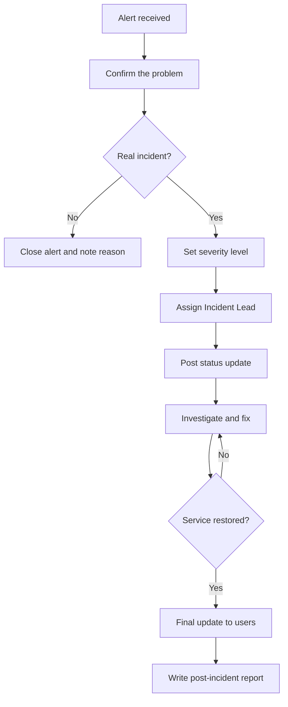
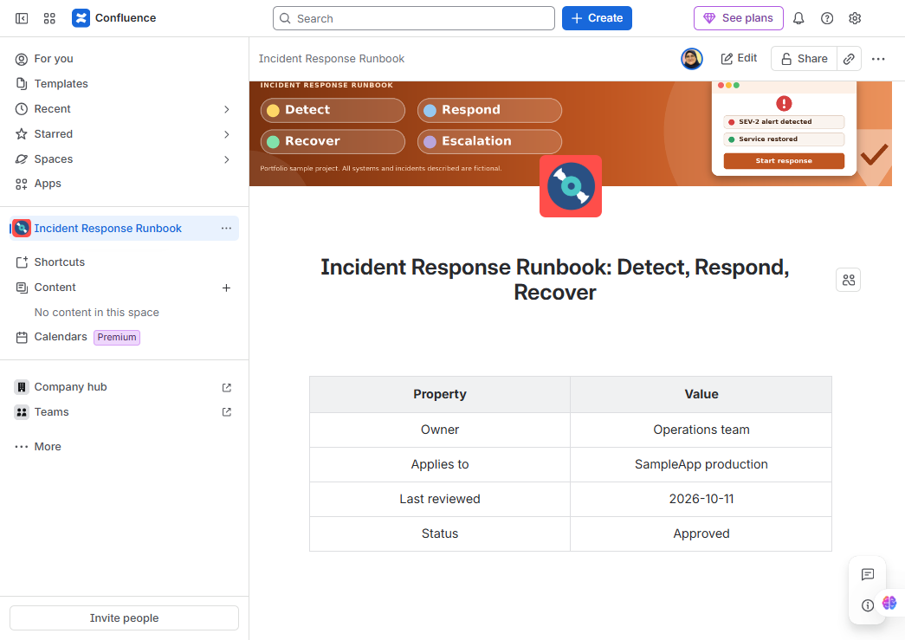
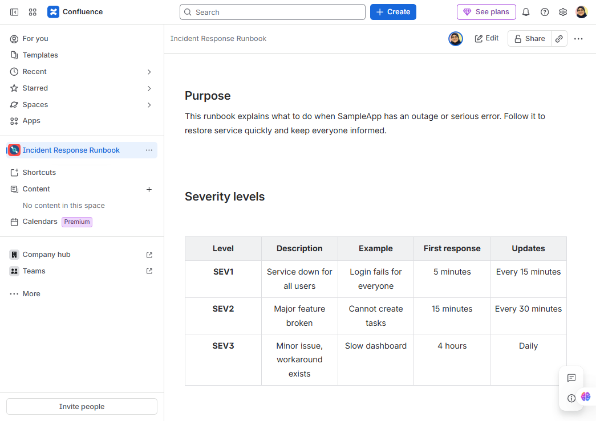
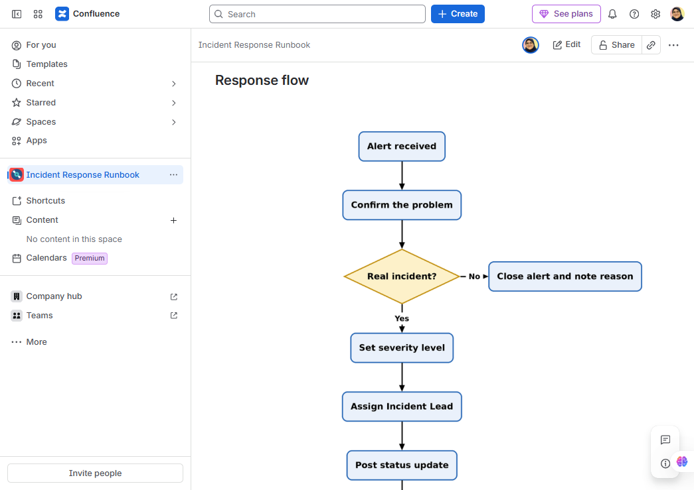
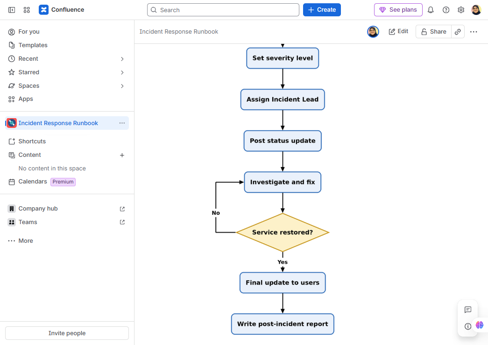
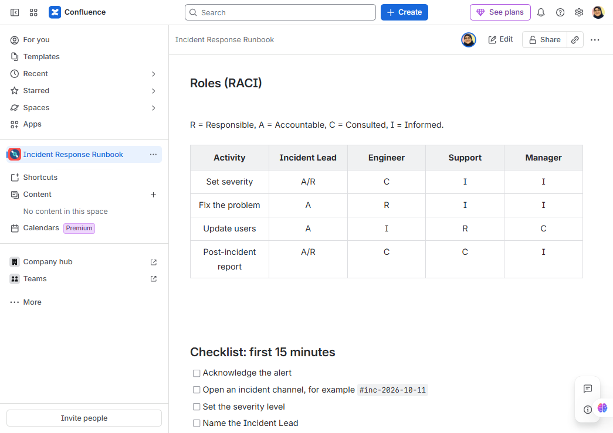
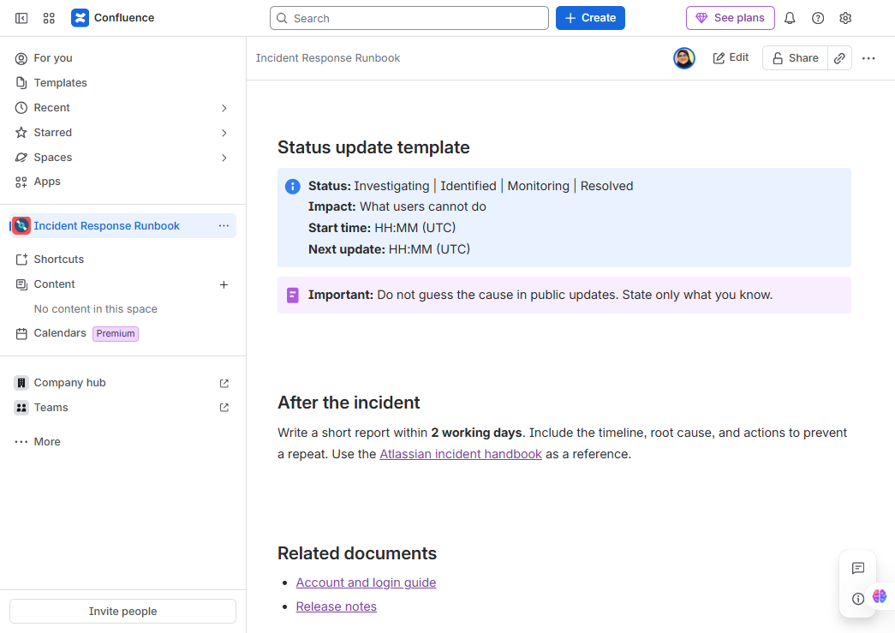

# Incident Response Runbook: Detect, Respond, Recover


[View screenshots of the Confluence page](#screenshots-of-the-confluence-page)

| Property | Value |
|----------|-------|
| Owner | Operations team |
| Applies to | SampleApp production |
| Last reviewed | 2026-10-11 |
| Status | Approved |

## Purpose
This runbook explains what to do when SampleApp has an outage or serious error. Follow it to restore service quickly and keep everyone informed.

## Severity levels
| Level | Description | Example | First response | Updates |
|-------|-------------|---------|----------------|---------|
| **SEV1** | Service down for all users | Login fails for everyone | 5 minutes | Every 15 minutes |
| **SEV2** | Major feature broken | Cannot create tasks | 15 minutes | Every 30 minutes |
| **SEV3** | Minor issue, workaround exists | Slow dashboard | 4 hours | Daily |

## Response flow


## Roles (RACI)
R = Responsible, A = Accountable, C = Consulted, I = Informed.

| Activity | Incident Lead | Engineer | Support | Manager |
|----------|:-------------:|:--------:|:-------:|:-------:|
| Set severity | A/R | C | I | I |
| Fix the problem | A | R | I | I |
| Update users | A | I | R | C |
| Post-incident report | A/R | C | C | I |

## Checklist: first 15 minutes
- [ ] Acknowledge the alert
- [ ] Open an incident channel, for example `#inc-2026-10-11`
- [ ] Set the severity level
- [ ] Name the Incident Lead
- [ ] Post the first status update

## Status update template
```text
Status: Investigating | Identified | Monitoring | Resolved
Impact: What users cannot do
Start time: HH:MM (UTC)
Next update: HH:MM (UTC)
```

> **Important:** Do not guess the cause in public updates. State only what you know.

## After the incident
Write a short report within **2 working days**. Include the timeline, root cause, and actions to prevent a repeat. Use the [Atlassian incident handbook](https://www.atlassian.com/incident-management/handbook) as a reference.

## Related documents
- [Account and login guide](https://github.com/mai-aamer/account-and-login-guide)
- [Release notes](https://github.com/mai-aamer/release-notes-v2-1-0)

## Screenshots of the Confluence page

This runbook was designed and published in Confluence. The screenshots below show the final page, from top to bottom.












